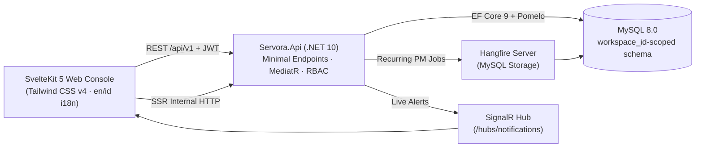

# Servora

**Servora** is an open-source, configurable, multi-industry **service, repair, and maintenance operations platform** built with **.NET 10**, **MySQL 8.0**, **Hangfire**, and **SvelteKit (Svelte 5 + Tailwind CSS v4)**.

Designed to serve both **commercial repair/service businesses** and **corporate subsidiaries or internal maintenance divisions** (internal IT, fleet, and facility/building maintenance), Servora adapts its terminology, custom asset/ticket fields, intake inspection checklists, statuses, and billing policies per workspace.

---

## Key Capabilities

### 1. Organization Hierarchy & Multi-Workspace Switching
- **Organizations & Workspaces:** Manage holding companies, multi-branch shops, subsidiaries, or internal corporate divisions under one deployment (`organizations`, `workspaces`, `organization_users`, `workspace_users`, `workspace_user_roles`).
- **Authoritative Workspace Isolation:** Every workspace switch issues a validated workspace-scoped session; backend `IShopContext` and `PermissionAuthorizationHandler` verify active DB membership on every request.
- **Organization Executive Overview (`/app/organization`):** Rollup KPIs across all branches/divisions (open work orders, overdue SLAs, completed today, tracked assets, due preventive maintenance, and collected revenue).

### 2. Dual Operating Modes (`Commercial` · `InternalMaintenance` · `Hybrid`)
- **Commercial Mode:** External retail/B2B customers, estimates & approval requests, configurable tax & rounding, invoices, payment tracking, unpaid-pickup override policies, printable receipts, and token-gated public tracking (`/track/[token]`).
- **Internal Maintenance Mode:** Internal departments, employees, cost centers, SLA targets, and zero-cost internal work orders (no retail cashier/payment blockers) with optional internal cost tracking.
- **Hybrid Mode:** Run both external customer repair orders and internal maintenance work orders in the same workspace.

### 3. Multi-Industry Blueprints, Dynamic Fields & Bilingual Terminology
Built-in selectable blueprints with full **English (`en`)** and **Bahasa Indonesia (`id`)** support:

| Blueprint Key | Industry / Use Case | Default Mode | Terminology (`en` / `id`) | Meter / Identifier Focus |
|---|---|---|---|---|
| `it_computer` | Laptop & PC Repair | Commercial | Device / Perangkat · Service Ticket | Serial Number, CPU/RAM/Storage, BIOS & Boot checklist |
| `mobile_phone` | Mobile Phone & Tablet Repair | Commercial | Device / Perangkat · Repair Ticket | IMEI/Serial, Storage/Color, Screen/Camera/Liquid checklist |
| `automotive_vehicle` | Motorbike & Car Workshop | Commercial | Vehicle / Kendaraan · Repair Order | License Plate, VIN/Chassis, Odometer (`km`), Walkaround |
| `hvac_ac` | AC & HVAC Field Service | Commercial | AC Unit / Unit AC · Service Visit | Indoor/Outdoor Serial, BTU/PK, Refrigerant, Site Address |
| `facility_internal` | Facility & Internal Equipment | InternalMaintenance | Equipment / Peralatan · Work Order | Asset Tag, Building/Floor/Room, Criticality, LOTO Safety |
| `custom` | Custom / Blank Blueprint | Hybrid | Asset / Aset · Service Ticket | Clean starter statuses ready to customize |

- **First-Run & New Workspace Setup Wizard (`/app/onboarding`):** 4-step guided wizard for Organization/Workspace profile, Operating Mode, Blueprint selection with live preview & editable terminology, and optional sample demo data seeding.
- **Dynamic Custom Fields (`/app/settings/blueprints`):** Typed fields (`Text`, `Number`, `Select`, `Boolean`, `Date`, `Multiline`) scoped to `Asset` or `Ticket`, individually toggleable for intake forms, detail views, printouts, and public tracking.
- **Configurable Intake Checklists:** Industry-specific Pass / Issue / N/A inspection templates stored per ticket.

### 4. On-Site Field Service & Preventive Maintenance
- **Field Service Modes (`InShop`, `OnSite`, `PickupDelivery`):** Saved site/branch addresses (`customer_locations`), scheduled visit windows, technician dispatch, and multi-asset linking (`service_ticket_assets`) for multi-unit visits.
- **Preventive Maintenance (`/app/maintenance`):** Recurring schedules (`maintenance_schedules`) driven by **calendar intervals** (days/weeks/months), **usage meters** (`km` / runtime hours), or **both**.
- **Hangfire Recurring Scheduler:** Hourly `PreventiveMaintenanceJob` scans due/upcoming schedules, emits notifications and activity logs, and optionally auto-creates scheduled work orders with checklist items from linked service templates.

### 5. Complete Operational Modules
- Service Tickets & Kanban Board (status transition rules, approvals, attachments/photo evidence, work items, spare parts consumption, history timeline)
- Parts Inventory & Stock Movements (reservations, CSV/bulk import, valuation)
- Internal Workshop / Division Equipment Assets (`workspace_assets`, custody & depreciation)
- Staff Attendance & Full-Time / Freelance Technician Payroll
- Reports, Activity Logs, Printable Receipts & Token-Gated Public Tracking Portal (`/track/[token]`) with self-service Quote Approval and optional 6-digit OTP verification
- Multi-Channel Notifications (SMTP Email, WhatsApp via Meta Cloud / Fonnte / WAHA / Custom HTTP, Telegram Bot API, HMAC-SHA256 Signed Outbound Webhooks), Account Auth Emails (Forgot Password, Staff Invite, optional Public Registration), and Staff Login 2FA (Authenticator TOTP + Email OTP + 8 recovery codes)

---

## Architecture Overview



---

## Quick Start (Docker Compose)

1. Clone the repository and create your environment file:
   ```bash
   cp .env.example .env
   ```
2. Update `DB_PASSWORD`, `JWT_KEY`, and `ADMIN_PASSWORD` in `.env`.
   - Set `SEED_INCLUDE_DEMO_DATA=true` if you want sample demo data and a second pre-configured internal maintenance workspace for immediate evaluation.
3. Start the full stack (MySQL 8.0 + .NET 10 API + SvelteKit frontend):
   ```bash
   docker compose up -d --build
   ```
4. Open Servora in your browser:
   - **Web Console:** `http://localhost:3000`
   - **API Health:** `http://localhost:5000/health`
   - **Default Admin Login:** `admin@example.com` / `Admin123!` (or the values configured in `.env`)

---

## Local Development Setup

### Prerequisites
- [.NET 10 SDK](https://dotnet.microsoft.com/)
- [Node.js 22+](https://nodejs.org/)
- MySQL 8.0 (local or via `docker compose up -d mysql`)

### 1. Run the Backend API
```bash
cd backend
dotnet restore Servora.sln
dotnet build Servora.sln

# Run with automatic migration + seed in Development:
cd src/Servora.Api
Database__db_port=3307 Database__db_password=servora_dev_password SeedData__RunOnStartup=true dotnet run
```
Swagger UI is available in Development at `http://localhost:5051/swagger` and Hangfire Dashboard at `http://localhost:5051/hangfire`.

### 2. Run the Frontend Console
```bash
cd frontend
npm ci
PUBLIC_API_BASE_URL=http://localhost:5051/api/v1 npm run dev
```
Open `http://localhost:5173`.

### 3. Run Automated Tests
```bash
cd backend

# Fast unit tests (calculators, blueprints, preventive maintenance scheduling)
dotnet test tests/Servora.Api.UnitTests/Servora.Api.UnitTests.csproj

# Integration tests (requires Docker for Testcontainers MySQL 8.0)
dotnet test tests/Servora.Api.IntegrationTests/Servora.Api.IntegrationTests.csproj
```

```bash
cd frontend
npm run check
npm run build
```

---

## Environment Variables Reference

See [`.env.example`](.env.example) for a complete template:

| Variable | Default | Description |
|---|---|---|
| `ASPNETCORE_ENVIRONMENT` | `Production` | Runtime environment (`Development` enables Swagger & Hangfire dashboard) |
| `DB_HOST` / `DB_PORT` | `mysql` / `3306` | MySQL server host and port |
| `DB_USER` / `DB_PASSWORD` / `DB_NAME` | `root` / — / `servora` | MySQL credentials and database name |
| `JWT_KEY` | — | Symmetric HMAC-SHA256 signing secret (use 32+ random characters in production) |
| `JWT_ISSUER` / `JWT_AUDIENCE` | `ServoraApi` / `ServoraClients` | JWT issuer and audience validation values |
| `SECRET_ENCRYPTION_KEY` | — | AES-256-GCM key (`Security:SecretEncryptionKey`, 32-byte base64 or long passphrase) required in Production to encrypt per-workspace payment gateway credentials |
| `SEED_RUN_ON_STARTUP` | `true` | Apply EF Core migrations and seed roles, permissions, and initial admin on boot |
| `SEED_INCLUDE_DEMO_DATA` | `false` | Seed starter demo records and a secondary internal maintenance workspace |
| `ADMIN_EMAIL` / `ADMIN_PASSWORD` | `admin@example.com` / `Admin123!` | Initial Owner/Admin bootstrap account |
| `DEFAULT_TIMEZONE` | `Asia/Jakarta` | Default IANA timezone for new workspaces |
| `PUBLIC_API_BASE_URL` | `http://localhost:5000/api/v1` | Browser-accessible API base URL |
| `INTERNAL_API_BASE_URL` | `http://api:8080/api/v1` | Server-side SSR API base URL inside Docker networks |
| `PUBLIC_FRONTEND_BASE_URL` | `http://localhost:3000` | Public frontend URL used for `/track/[token]` links and CORS |

---

## Blueprint & Workspace Configuration Guide

1. **Initial Setup:** Sign in as `Owner/Admin` and click **Open Setup Wizard** (or visit `/app/onboarding`).
2. **Customize Anytime:** Go to **Insights & System → Blueprints & Fields** (`/app/settings/blueprints`) to:
   - Switch between `Commercial`, `InternalMaintenance`, and `Hybrid` operating modes.
   - Override bilingual `en` and `id` labels (e.g. *Device* → *Vehicle* / *AC Unit* / *Equipment*, *Ticket* → *Repair Order* / *Work Order*).
   - Add typed custom fields for Assets or Tickets and control where each field appears (Intake, Detail, Printout, Public Tracking).
   - Edit intake inspection checklists.
3. **Add Branches or Internal Divisions:** Open the **Workspace Switcher** in the left sidebar and click **+ New Workspace** to provision a separate branch, subsidiary, or internal maintenance division under the same organization.

---

## License

Licensed under the [MIT License](LICENSE).
